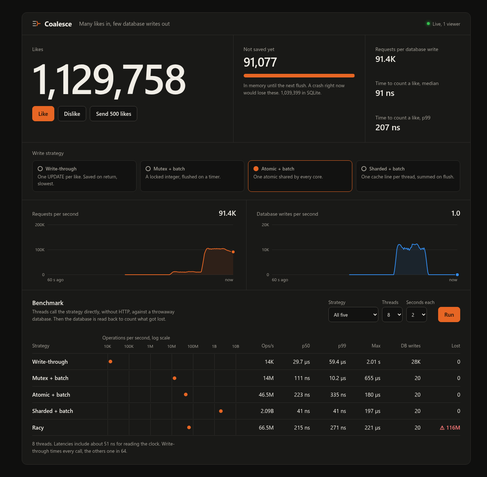
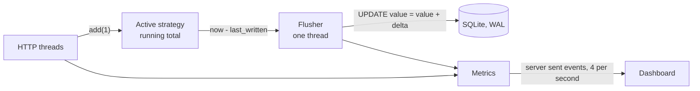

# Coalesce

A live lab for one question: **how do you persist a counter that receives far more writes than your database can take, and what does each approach cost?**

One C++20 binary serves an HTTP counter, stores it in SQLite, and shows what happens inside on a live dashboard. Switch the write strategy while requests are flowing, benchmark them side by side, and watch one of them lose updates.



## Results

Ryzen 7 7435HS (8 cores, 16 threads), Linux 7.3, GCC 16.2, release build, btrfs on NVMe. One run of 5 seconds per cell, 100 ms flush interval.

**Strategy alone, no HTTP**, operations per second:

| Strategy | 1 thread | 4 threads | 8 threads | 16 threads | Lost updates |
|---|---:|---:|---:|---:|---:|
| Write-through | 13.8K | 13.7K | 13.7K | 17.4K | 0 |
| Mutex + batch | 92.7M | 32.9M | 18.5M | 18.3M | 0 |
| Atomic + batch | 259M | 37.2M | 46.6M | 32.3M | 0 |
| Sharded + batch | 276M | 1.11B | 2.16B | **2.82B** | 0 |
| Racy, wrong on purpose | 284M | 96.0M | 66.9M | 96.4M | **up to 93%** |

**Whole path over HTTP**, 16 keep-alive clients, `ab`, 1 s flush interval:

| Strategy | Requests per second |
|---|---:|
| Write-through | 12,563 |
| Mutex + batch | 124,880 |
| Atomic + batch | 127,853 |
| Sharded + batch | 119,847 |

What I take from this:

- **Batching is the win that matters in practice.** About 10 times the HTTP throughput, with one database write per second instead of one per request.
- **Sharding is 87 times faster than one atomic at 16 threads, and it makes no difference here.** Over HTTP the three batched strategies are within noise of each other, because parsing a request costs far more than any of them.
- **A single atomic gets slower as cores are added** (259M to 32M), because every core needs the same cache line.
- **Averages lie.** Write-through at 8 threads has a p99 of 57 µs and a worst case of 3.4 s: `std::mutex` is not fair, so some threads starve.
- **Two relaxed operations are not one.** The racy strategy has no data race by the C++ rules, and still lost 447 million of 482 million updates.

## How it works



| Strategy | Idea |
|---|---|
| Write-through | one `UPDATE` per like |
| Mutex + batch | a locked integer, flushed on a timer |
| Atomic + batch | one `std::atomic`, flushed on a timer |
| Sharded + batch | 64 atomics on separate cache lines, summed on flush |
| Racy | separate load and store, benchmark only |

Decisions worth knowing:

- **Running totals never reset.** The flusher writes `now - last_written` and moves `last_written` only after the write succeeded. A failed write is retried with a bigger delta, and readers never see the count dip during a flush.
- **Deltas, not totals.** Several processes can share one database file without overwriting each other.
- **Switching is safe.** Every batched strategy is flushed on every tick, so likes left in the old one still get saved.
- **Benchmarks check themselves.** Each run uses a throwaway database on the same disk, reads it back, and compares it with the number of operations.
- **Clean shutdown.** SIGINT and SIGTERM finish open requests, then flush once more.

## Run it

Needs CMake 3.24 and a C++20 compiler. Uses installed cpp-httplib, SQLiteCpp, nlohmann-json and GoogleTest, or downloads pinned versions.

```sh
cmake --preset release && cmake --build --preset release
./build/release/coalesce --port 8080 --db likes.db
```

Open <http://localhost:8080>. Options: `--host`, `--port`, `--db`, `--flush-ms`.

From a second terminal:

```sh
curl -X POST localhost:8080/like
curl -X POST localhost:8080/dislike
curl localhost:8080/current

# write_through, mutex_batch, atomic_batch, sharded_batch
curl -X PUT localhost:8080/api/strategy \
     -H 'Content-Type: application/json' -d '{"strategy":"sharded_batch"}'

# strategy can also be racy or all. up to 64 threads and 10 seconds
curl -X POST localhost:8080/api/bench \
     -H 'Content-Type: application/json' -d '{"strategy":"atomic_batch","threads":8,"seconds":3}'
curl localhost:8080/api/bench

# live samples, ctrl+c to leave
curl -N localhost:8080/api/stream
```

Reproduce the HTTP table with `scripts/http_load.sh` against a throwaway `--db`.

## Tests

```sh
cmake --preset tsan && cmake --build --preset tsan && ctest --preset tsan
```

Presets: `release`, `tsan` (ThreadSanitizer), `asan` (AddressSanitizer and UBSan). The tests cover exact totals under contention, switching under load, retry after a failed write, restarts, two connections on one database, percentile accuracy and the HTTP API.

## Limits

- Batching trades durability for speed. A crash loses up to one flush interval; the dashboard shows how many likes are at risk.
- SQLite runs in WAL mode with `synchronous=NORMAL`. Saved likes survive a process crash. A power cut can lose the most recent commits.
- The benchmark is a closed loop: a stalled thread sends nothing, so percentiles understate stalls (coordinated omission). That is why the maximum is shown too.
- Latencies include about 41 ns for reading the clock. Batched strategies are timed on one call in 64.
- With several processes on one database, each shows its own view until it restarts. The database total is always right.
- The server has no login and listens on `127.0.0.1` only. Anyone who can reach it can start a benchmark, so do not expose it as it is.
